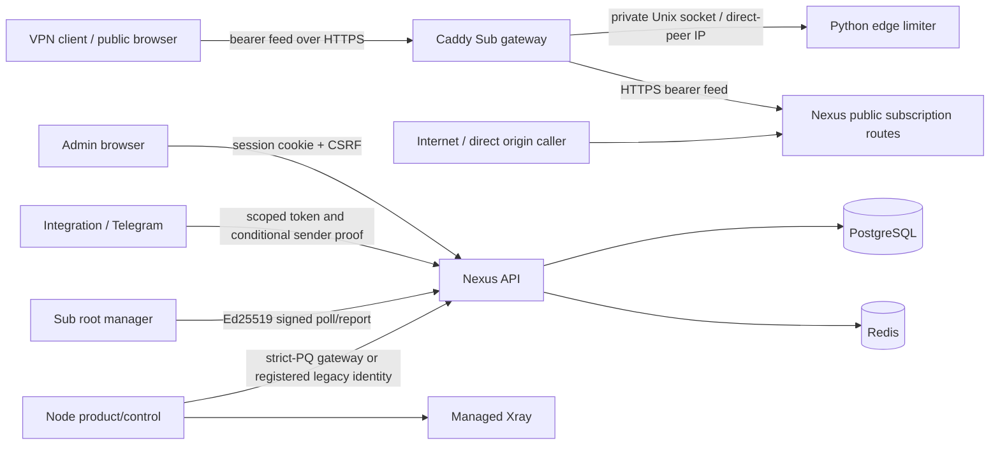

# Threat model — first pass

Method: STRIDE. The topology below is reconstructed from the reviewed routers, Compose definitions, agent code and rendered Sub configuration; operational deployment must still be verified.

## Attacker roles and trust boundaries

| Role | Available resource | Principal threats | Existing boundary observed | Required proof / remaining work |
|---|---|---|---|---|
| Anonymous Internet | public auth/feed/health/machine routes | S, T, D: credential spray, resource exhaustion, origin bypass | session middleware, token grammar, Redis/local feed budgets | API-wide pre-auth cost inventory, concurrent/fault tests |
| Valid VPN subscriber | one bearer URL and client credentials | I, E: other subscribers, device/quota bypass | token-hash lookup and per-user generation | BOLA, device identity spoofing, revocation and cross-node quota tests |
| Expired/disabled subscriber | stale URL/config | T, E: reuse old access | status/quota/policy checks exist | real traffic denial and delayed/offline sync bounds |
| Stolen feed token | victim bearer capability | I: feed/client-secret disclosure | no browser session needed by design | quantify exact bearer scope, rotation, expiry and gateway visibility |
| Stolen Integration key | token scopes/grants | E, T: unauthorized writes and replay | scoped namespace; sender proof for protected tokens; legacy proof policy conditional | every scope/object/expiry/idempotency negative case |
| Limited administrator | admin/viewer session | E, I: owner operations and secret reads | role guards and viewer redaction | route-by-route guard/data-flow verification |
| Compromised Node | own host keys/config/assigned VPN credentials | S, T, E: other nodes, forged usage, control-plane abuse | node/path signature binding; product identity; replay state | cross-node signed requests, assigned-user enforcement, worst credential blast radius |
| Compromised Sub host | public feeds it proxies; own manager key | I, T, D: malicious feeds, mirror impersonation, origin flood | no panel admin cookie; fixed manager operation; Ed25519 selector/signature | mirror revocation, report ownership, origin authentication options |
| Network response attacker | DNS/routing/traffic under stated TLS assumptions | S, T: redirect/replay/downgrade/update substitution | normal TLS validation; strict-PQ product; attestation identity | per-client redirect checks and key/epoch failure injection |
| One container | its user/caps/mounts/network | E, I: host/socket/key escape | read-only roots/cap drops in several services; signer separated | exact UID/mount/networks, secret reachability, resource limits |

STRIDE: S spoofing, T tampering, R repudiation, I disclosure, D denial of service, E elevation. Audit signatures and journal durability address R only if identity, retention and storage failure semantics hold; this has not yet been revalidated.

## Central question

A Sub or Node identity must never become a panel administrative identity. Public feed confidentiality is a separate boundary: a gateway terminating HTTPS can see and replace the content it serves. A compromised Node may possess VPN credentials also usable on other assigned nodes; that is not equivalent to gaining Nexus administrative authority. Both blast radii require explicit tests and documentation rather than an absolute isolation claim.

Owner/API/root/release-publisher privileges are distinct. No claim is made that a fully compromised trusted release publisher or panel owner can be isolated by client-side labels.
